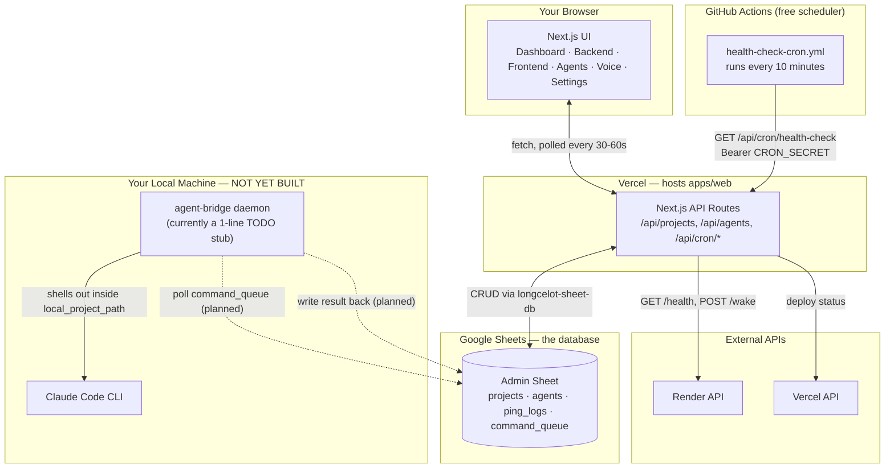
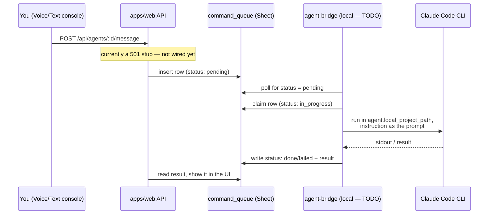
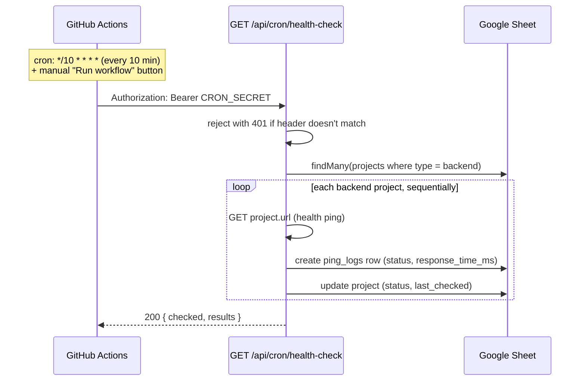

# Project Control Center — Architecture & Runtime Guide

This doc explains how the pieces actually connect right now, checked directly against the
source — not what the original plan proposed. See [project-control-center-plan.md](./project-control-center-plan.md)
for the original design rationale and phased build order.

> **Note on `CLAUDE.md`:** it currently describes this repo as a "structure-only scaffold" where
> every API route 501s. That line is stale — `Tasks/agent-chat.md` shows the frontend and backend
> work has since landed real functionality. §6 below is the up-to-date built-vs-stubbed status.

## 1. How the pieces connect



Solid arrows are live and working today. Dashed arrows into `agent-bridge` are the planned
design — that daemon doesn't do anything yet.

## 2. Hosting: is Vercel enough, or do I need a separate backend?

**Vercel alone is enough for everything except talking to your agents.**

- **Portal (`apps/web`)** — a normal Next.js app. Deploy it to Vercel like any other Next.js
  project. Its "API routes" (`/api/projects`, `/api/agents`, `/api/cron/health-check`, etc.) run
  as Vercel serverless/edge functions — there's no separate Express server or container to stand
  up.
- **Database** — not Postgres/Mongo, it's a Google Sheet accessed through `longcelot-sheet-db`. No
  database server to host either.
- **Cron** — the one place a "separate backend" shows up, but it's not a backend, it's GitHub
  Actions. Vercel Cron's Hobby tier only allows daily schedules, which is too infrequent to keep
  a Render free-tier service from sleeping (~15 min idle timeout). So the repo uses
  `.github/workflows/health-check-cron.yml` (runs every 10 min, free on GitHub) to hit
  `/api/cron/health-check` instead. If you ever move to Vercel Pro, you could swap this for
  native Vercel Cron.
- **The one genuine exception: `agent-bridge`.** Vercel's serverless functions have no access to
  *your* laptop's filesystem, and can't run a long-lived process. Anything that needs to act on
  local project files (Claude Code executing inside a project directory) structurally cannot run
  on Vercel — see §3.

So: **one Vercel deployment + one free GitHub Actions workflow** covers monitoring and the whole
portal UI. You only need something running outside Vercel once you want the Agent Staff feature
to actually execute commands.

## 3. Where agent-bridge runs, and how

By design (plan §4.4, Option A) it's a **small daemon that runs on your own machine**, not on
Vercel — this is the intentional bridge between the hosted portal and your local filesystem,
since Vercel can't reach either.

**Today, it does nothing.** The entire implementation is:

```ts
// apps/agent-bridge/src/index.ts
// TODO: poll command_queue via packages/db
```

None of `Tasks/agent-bridge.md`'s checklist is checked off. Here's the intended flow once it's
built:



Practically, once built, running it day-to-day means:

- It needs the **same Google Sheets credentials** as `packages/db` (it depends only on `@pcc/db`
  + `@pcc/types`, never on `apps/web`) — no separate credential set.
- It must be **kept running continuously** for agent execution to work at all — if it's not
  running, commands just sit as `pending` forever. `Tasks/agent-bridge.md` §4 explicitly flags
  this as an open packaging decision: manual `pnpm --filter @pcc/agent-bridge dev`, a
  `launchd`/systemd service, or `pm2`. Nothing has been picked yet.
- The task list also flags the underlying design itself as unconfirmed — plan §10's "Option A vs
  Option B" (run a local daemon vs. deep-link out to Claude Code/Cowork's own remote-access
  feature instead of reimplementing execution) is still an open decision, not just an
  implementation detail.

## 4. Environment variable setup, step by step

Two `.env.example` files exist on purpose (`packages/db/.env.example` and
`apps/web/.env.example`) because Sheets credentials and Render/Vercel credentials are different
concerns — but **Next.js only loads env files from `apps/web/`**, not sibling packages, so
several values have to be duplicated into `apps/web/.env` even though they're conceptually "the
db package's" variables.

1. **Google Cloud project** — in [console.cloud.google.com](https://console.cloud.google.com),
   enable the Sheets API and Drive API, then create an OAuth 2.0 Client ID. Put the values in
   `packages/db/.env`:
   ```
   GOOGLE_CLIENT_ID=
   GOOGLE_CLIENT_SECRET=
   GOOGLE_REDIRECT_URI=http://localhost:3000/auth/callback
   ```
2. **Create the admin Google Sheet** and copy its ID into `ADMIN_SHEET_ID` (same file).
3. **Run the one-time OAuth consent flow**: `pnpm --filter @pcc/db db:sync` (this is
   `lsdb sync`). It walks you through browser consent and writes
   `packages/db/.lsdb-tokens.json`. Copy the `refresh_token` value out of that file into
   `ADMIN_OAUTH_REFRESH_TOKEN`.
4. **Mirror into `apps/web/.env`** — copy `GOOGLE_CLIENT_ID`, `GOOGLE_CLIENT_SECRET`,
   `GOOGLE_REDIRECT_URI`, `ADMIN_SHEET_ID`, and `ADMIN_OAUTH_REFRESH_TOKEN` in verbatim. This is
   the step that's easy to miss — the API routes run in the `apps/web` process and won't see
   `packages/db/.env` at all.
5. **Render + Vercel tokens** — generate `RENDER_API_KEY` (Render account settings) and
   `VERCEL_API_TOKEN` (Vercel account settings), add both to `apps/web/.env`.
6. **Auth gate for the portal itself** — this is a *separate* Google OAuth Web Client from step 1
   (used for logging into the portal, not for Sheets access):
   ```
   GOOGLE_OAUTH_CLIENT_ID=
   GOOGLE_OAUTH_CLIENT_SECRET=
   GOOGLE_OAUTH_REDIRECT_URI=http://localhost:3000/api/auth/google/callback
   AUTH_ALLOWED_EMAIL=          # the one email allowed to sign in
   AUTH_PASSWORD_HASH=          # generate: see the node one-liner in apps/web/.env.example
   AUTH_SESSION_SECRET=         # generate: node -e "console.log(require('crypto').randomBytes(32).toString('hex'))"
   ```
7. **`CRON_SECRET`** — any random string. Set it in three places: `apps/web/.env` locally, your
   Vercel project's environment variables (production), and as a **GitHub repo secret** (see step
   8).
8. **Deploy `apps/web` to Vercel** — set every `apps/web/.env` variable above in the Vercel
   project's Environment Variables settings (Production, and Preview if you want preview deploys
   to work too).
9. **Wire up the GitHub Actions cron** — in the GitHub repo's Settings → Secrets, add:
   - `CRON_SECRET` — same value as step 7/8
   - `PORTAL_URL` — your deployed Vercel URL (e.g. `https://your-app.vercel.app`)

   No code changes needed — `.github/workflows/health-check-cron.yml` already reads both secrets.
10. **Agent-bridge** — not a new credential set once it's built (reuses `packages/db`'s Sheets
    creds per its task list), but there's nothing meaningful to run yet — see §3.

## 5. The auto-triggering process (health-check cron)

This is the one piece of "automation" that's actually live today:



Two details worth knowing, both deliberate per the code comments in
`apps/web/src/app/api/cron/health-check/route.ts`:

- **Why GitHub Actions, not Vercel Cron:** Vercel Cron's Hobby tier is daily-only; a Render
  free-tier service sleeps after ~15 min idle, so a daily ping is useless for keeping it warm.
  GitHub Actions' every-10-minutes schedule is free and does the job. The route itself is
  scheduler-agnostic (just checks a bearer token), so it'd work unchanged if you moved to Vercel
  Pro and swapped schedulers later.
- **Why sequential, not parallel:** projects are pinged one at a time in a loop, not with
  `Promise.all`, specifically to avoid bursting past Google Sheets' 60-reads/min quota as the
  project count grows (plan §11).

## 6. What's actually built vs. stubbed right now

| Area | State |
|---|---|
| Frontend (`apps/web` UI) | All 6 pages built, wired to real data, auth gate working |
| `/api/projects`, `/api/agents` CRUD | Implemented |
| `/api/projects/:id/health`, `/wake`, `/deploy-status` | Implemented |
| `/api/cron/health-check` | Implemented, live via GitHub Actions |
| `/api/agents/:id/message` | **501 stub** — blocked on agent-bridge |
| `apps/agent-bridge` | **Not started** — single TODO comment, no polling/execution logic |
| `/api/settings` | **Not built** — no route file exists yet; a `settings` key/value schema is proposed in `Tasks/agent-chat.md` but not added to `packages/db` (open request, unresolved) |
| Voice console | UI renders (mic capture, transcript, canned commands); actual send is a visible "not wired yet" state |

The practical takeaway: you can run and deploy the monitoring half of this today. The "agent
staff" half needs `agent-bridge` built (and the Option A vs. B decision in plan §10 settled)
before it does anything beyond storing roster records.
